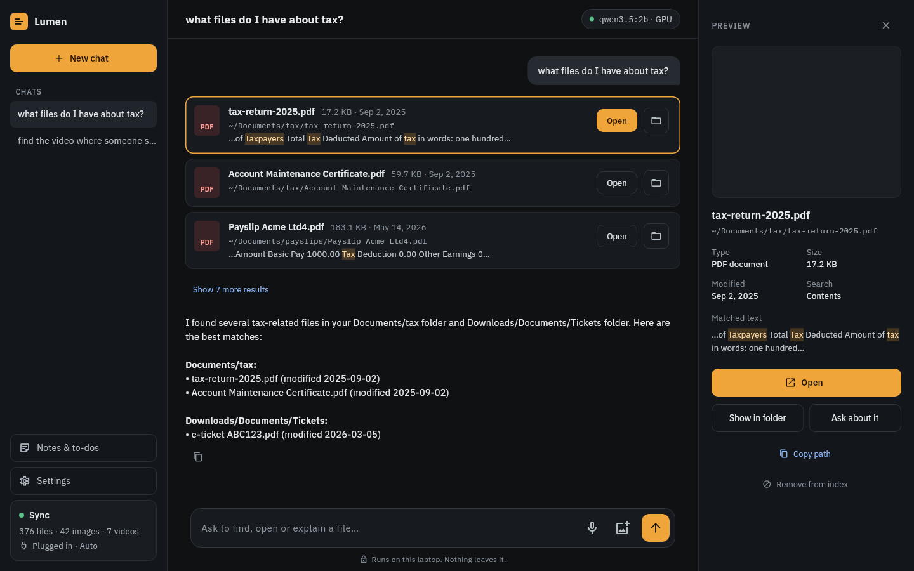
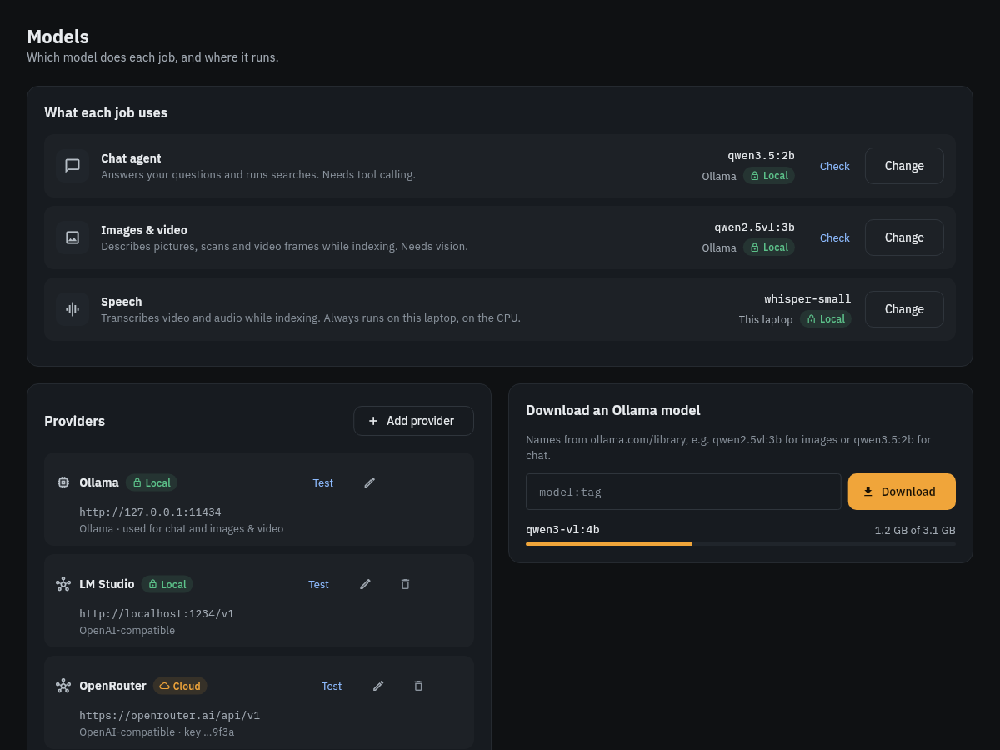
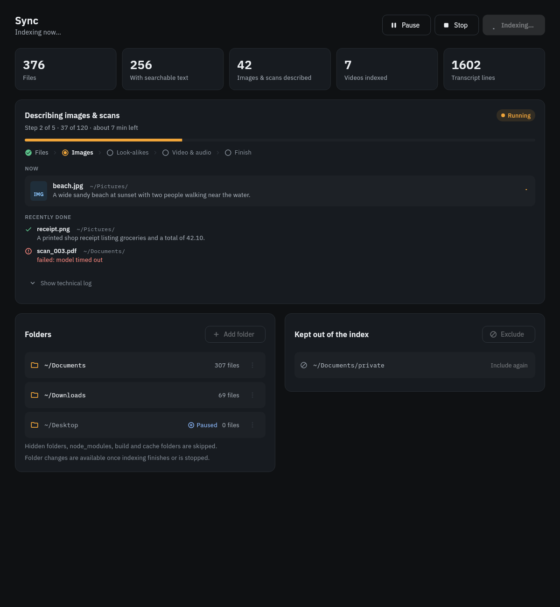

# Lumen

A local AI assistant for your files. Ask in your own words, "find my CV", "photos of the beach", "the video where someone asks when the last train leaves", and Lumen finds it: by name, by the text inside documents, by what images and videos show, and by what is said in them.

It runs on your laptop with a local model (Ollama) by default. Nothing leaves the machine unless you point it at a cloud provider yourself.



## What it does

- **Searches everything you index**: file names, the text of PDFs, Word files, notes and code, descriptions of photos and scanned pages, and transcripts of video and audio with timestamps ("play it at 10:05").
- **Finds pictures by what they show**, and finds images that look like a given photo (drop one on the chat).
- **Answers questions about a file** by reading it, and opens files or shows them in their folder.
- **Organises files with your approval**: create folders and files, copy, move and rename. Every change asks first and can be undone. It cannot delete anything.
- **Indexes quietly**: low CPU and disk priority, and in Auto mode the AI work only runs while plugged in. Pause, resume or stop a run any time, and see live progress.
- **Desktop and phone app** (Flutter): the Linux desktop app, plus a phone app that pairs with your laptop over the local network.

## How it works

```
Flutter app (desktop / phone)
        │  HTTP
        ▼
lumen serve ── chat agent (LangGraph + tools) ── model provider (Ollama or OpenAI-compatible)
        │
        └── lumen index (separate low-priority process)
              files → text (PDF, DOCX, text/code)
              images & scans → descriptions (vision model)
              video & audio → frame descriptions + speech transcripts (faster-whisper, CPU)
              images → visual signatures for search and look-alikes (CLIP, CPU)
              everything → SQLite full-text index
```

Data lives in one folder (`~/.local/share/lumen` by default): the index, chats, settings and provider keys.

## Quick start

You need Python 3.12 with [uv](https://docs.astral.sh/uv/), [Ollama](https://ollama.com) and `ffmpeg`.

```bash
git clone https://github.com/wasif-farooq/lumen.git
cd lumen
uv sync

ollama pull qwen3.5:2b        # chat and image descriptions (small, fast)

uv run lumen index            # index ~/Documents, ~/Downloads and ~/Desktop
uv run lumen chat             # chat in the terminal
```

Other commands:

```bash
uv run lumen ask "what files do I have about tax?"
uv run lumen search invoice --ext pdf --after 2025-01-01
uv run lumen stats
uv run lumen serve            # API for the app on 127.0.0.1:8765 (add --lan for phones)
```

## The app

Start the API with `uv run lumen serve`, then run the app:

```bash
cd app
flutter run -d linux
```

To build the Linux app without installing a toolchain on your machine, build it in Docker:

```bash
docker compose --profile build run --rm app-build   # → app/dist/linux/lumen
```

More in [app/README.md](app/README.md), including the phone app and pairing.

| Settings: models and providers | Sync: live indexing progress |
|---|---|
|  |  |

## Models and providers

In **Settings → Models** you choose which model does each job:

- **Chat agent**: needs tool calling.
- **Images & video**: needs vision.
- **Speech**: a local whisper size, always on the CPU.

Models can come from Ollama (the app lists what you have and can download more) or any **OpenAI-compatible** server: LM Studio, llama.cpp, vLLM, OpenAI, OpenRouter. A new model is tried on its job before it is used: the chat model must call a tool, the vision model must read a test picture.

Providers outside your laptop and local network are marked **Cloud**, and Lumen asks before sending anything to one. API keys are stored only in your data folder, readable by your user account, and are never sent back to the app.

## Configuration

Most settings live in the app (Settings → General / Models / Sync). Environment variables set the defaults:

| Variable | Default | |
|---|---|---|
| `LUMEN_ROOTS` | `~/Documents:~/Downloads:~/Desktop` | Folders to index |
| `LUMEN_DATA` | `~/.local/share/lumen` | Where the index, chats and settings live |
| `LUMEN_MODEL` | `qwen3.5:2b` | Chat model on Ollama |
| `LUMEN_CAPTION_MODEL` | same as `LUMEN_MODEL` | Model that describes images and video |
| `LUMEN_WHISPER_MODEL` | `small` | Speech-to-text size |
| `LUMEN_POWER` | `auto` | `auto` (AI work only when plugged in), `saver` (no models), `performance` |
| `LUMEN_CPU_ONLY` | `0` | `1` keeps every model on the CPU |
| `LUMEN_THREADS` | `4` | CPU threads for indexing |
| `LUMEN_CAPTIONS`, `LUMEN_MEDIA`, `LUMEN_TRANSCRIPTS`, `LUMEN_VISUAL` | `1` | Turn indexing passes off with `0` |
| `LUMEN_WRITE` | `1` | `0` reports file changes instead of doing them |
| `OLLAMA_HOST` | `http://127.0.0.1:11434` | Ollama server |

Copy `.env.example` to `.env` for local overrides (it is git-ignored). Optional [Langfuse](https://langfuse.com) tracing is turned on by its `LANGFUSE_*` keys.

## Run in the background

`deploy/` has systemd user units: `lumen-api.service` keeps the API running, and `lumen-index.service` with `lumen-index.timer` re-indexes every 30 minutes at idle priority. Install instructions are at the top of `lumen-api.service` and `lumen-index.service`; first change `WorkingDirectory` and `LUMEN_DATA` in them to where you cloned Lumen.

## Try it safely in Docker

The Docker setup mounts your folders **read-only**, and opening files only reports what would be opened:

```bash
docker compose run --rm app index
docker compose run -d --rm --name lumen-api app serve
```

## Development

```bash
uv sync                                  # Python dependencies
cd app && flutter test                   # UI tests against recorded API responses
flutter test --update-goldens            # refresh the screenshots in app/test/screens
```

The UI tests run the real screens against JSON fixtures in `app/test/fixtures`. They contain made-up demo data; don't record new fixtures from your own files without removing personal details first.

## License

[MIT](LICENSE)
